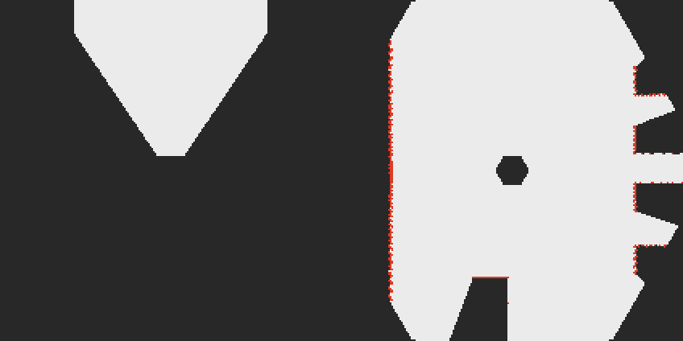
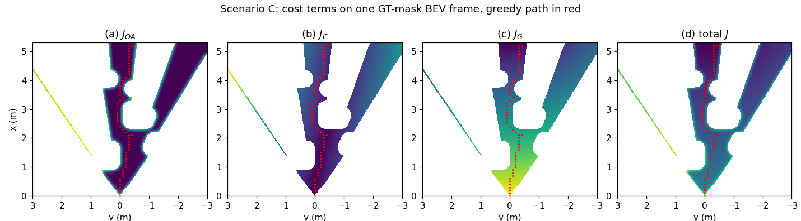
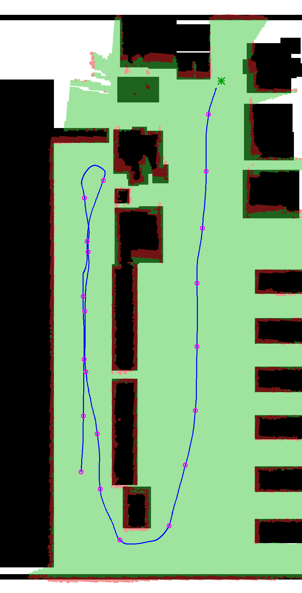
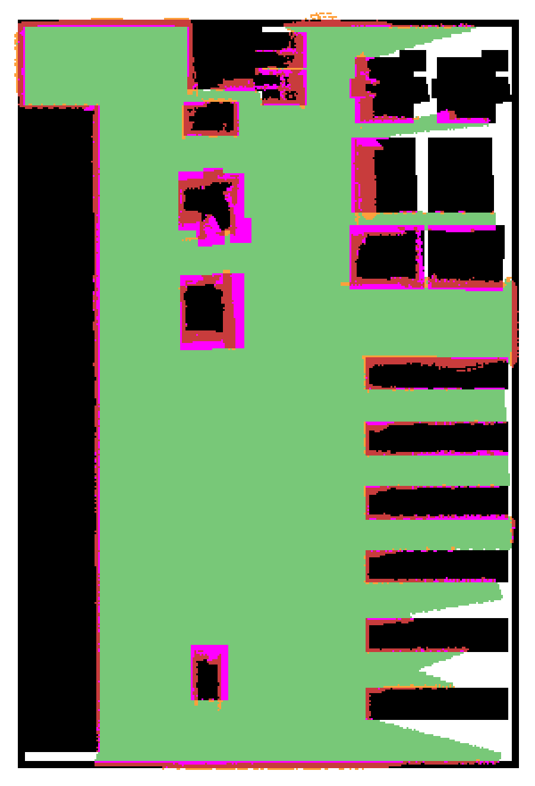

# BEVNav: Camera-Only Indoor Navigation with an Active Pan Scan and a Persistent Bird’s-Eye-View Map

BEVNav is a ROS 2 navigation stack for a small ground rover that sees the world through **one
RGB camera on a pan joint** and no range sensor. The camera image is turned into a top-down
bird's-eye view (BEV) of the floor around the rover: what is free floor, where obstacles meet
the floor, and what has not been seen yet. The rover plans and drives on that view and keeps it
as a map, so it ends up with a BEV map of the whole space it has explored.

**How it works.** When the rover needs to look around, it stops and turns its camera through six
headings 60° apart. Each image becomes a floor mask, the mask is projected onto the ground plane,
and the six views are fused into one 360° occupancy grid around the rover. Every scan and every
forward view while driving is added to a persistent log-odds map. A local cost map cut from that
map steers a greedy planner and a pure-pursuit controller; a shortest route on the map gives the
planner its sub-goal, so the rover can back out of dead ends once it has seen them.

The stack runs in simulation (Gazebo Harmonic) in an indoor warehouse with six test scenarios.



*One forward camera view (left) versus one six-heading scan fused into a 360° grid (right).
Light = free floor, red = obstacle contact, dark = unknown. The hexagon in the centre is the
patch under the rover that the camera cannot see.*

| | |
| --- | --- |
| ROS | ROS 2 Jazzy (Ubuntu 24.04) |
| Simulator | Gazebo Harmonic via `ros_gz` |
| Rover | 4-wheel skid-steer, 0.375 × 0.40 m; RGB camera on a 0.45 m mast with a pan joint, 70° field of view, pitched 15° down |
| World | Indoor warehouse (AWS RoboMaker small warehouse) with six test scenarios |
| Pose | `robot_localization` EKF on wheel speed and gyro |
| Language | Python 3.12 (`rclpy`, NumPy, OpenCV, SciPy) |

## Pipeline

```text
 camera ─► floor mask ─► BEV view ──────────────┐   (every frame, camera facing forward)
              │          (projection + ray-cast) │
              │                                  ▼
              └─► 6-heading pan scan ─► 360° fusion ─► persistent map (odom, log-odds)
                  (stop, 6 × 60°)                         │
                                                          ├─► route sub-goal (shortest route)
                                                          ▼
                       480 × 480 window ─► cost map ─► greedy planner ─► pure pursuit ─► /cmd_vel
```

1. **BEV view.** The floor mask is warped onto a 480 × 480 grid (5.3 m ahead, ±3 m sideways)
   with a lookup table. A ray-cast keeps only what a ground-plane projection places correctly:
   floor before the first obstacle is free, the obstacle's contact with the floor is occupied,
   and everything behind it is unknown.
2. **Six-heading scan.** The rover stops and pans to 0°, 60°, … 300°. Each view is rotated by
   the measured pan angle and the six are fused in log-odds into one 360° grid in about 3.3 s.
3. **Persistent map.** Scans and forward views accumulate in a 50 × 50 m log-odds grid in
   `odom` (0.05 m cells). Every second a 480 × 480 window around the rover is cut from it for
   planning.
4. **Stop-and-scan.** A scan is requested at the start, every 2 m driven, and when the rover is
   blocked.
5. **Cost map, planner, controller.** The cost map combines obstacle distance, aisle centre-line
   and distance to the sub-goal; a greedy planner steps down it every second; pure pursuit follows
   the path at 20 Hz.
6. **Route sub-goal.** A shortest route to the goal on the map (unknown cells count as passable)
   places the planner's sub-goal 3 m along it.



*Cost-map terms on one frame among floor boxes: obstacle distance, centre-line, goal distance
and the total, with the planned path in red.*

## Repository layout

```text
src/
├── bevnav_core/   Pure-Python algorithms (no ROS): camera model, BEV, ray-cast, fusion,
│                  persistent map, cost map, planner, pure pursuit, metrics
├── bevnav_ros/    rclpy nodes, launch files, parameter YAML, RViz config
├── bevnav_sim/    Rover xacro, warehouse world and scenarios, models, ros_gz bridge, sim launch
└── bevnav_eval/   Trial runner, bag analysis, map tour, figures
```

All algorithms live in `bevnav_core` and work on NumPy arrays; nodes only convert messages, call
the core and publish. Every tunable value is a ROS parameter in `bevnav_ros/config/*.yaml`.

## Requirements

- Ubuntu 24.04 with ROS 2 Jazzy (`ros-jazzy-desktop`)
- `ros-jazzy-ros-gz` (pulls the matching Gazebo Harmonic), `ros-jazzy-robot-localization`,
  `ros-jazzy-xacro`
- `python3-opencv`, `python3-numpy`, `python3-scipy`
- A GPU that Gazebo's `ogre2` renderer can use

## Build

```bash
mkdir -p ~/bevnav_ws && cd ~/bevnav_ws
git clone <this repository> .
source /opt/ros/jazzy/setup.bash
rosdep install --from-paths src --ignore-src -y
colcon build --symlink-install
source install/setup.bash
```

Recorded bags and results go to `$BEVNAV_DATA` (default `~/bevnav_data`).

## Run

### Navigate a scenario

```bash
# Terminal 1: Gazebo, EKF, navigation and RViz
ros2 launch bevnav_ros bringup.launch.py scenario:=C pipeline:=full

# Terminal 2: send the scenario's goal (same scenario and seed as terminal 1)
ros2 run bevnav_eval send_goal C
```

The rover scans at the start, then drives, stopping to scan every 2 m. In RViz the
*Global map* display shows the BEV map growing, *BEV debug* the current forward view, and the
orange line the planned path.

`bringup.launch.py` arguments:

| Argument | Values | Default |
| --- | --- | --- |
| `scenario` | `A` straight aisle, `B` junction, `C` floor clutter, `D` 0.7 m gap, `G` dead end, `H` hidden goal | `A` |
| `pipeline` | `baseline` (current forward view only), `full` (scans, map and route) | `baseline` |
| `pose_source` | `ekf`, `gt` (simulator ground truth) | `ekf` |
| `seg_backend` | `gt` (simulator segmentation camera) | `gt` |
| `headless` | `true`, `false` | `false` |
| `seed` | integer; shifts the start pose by up to ±0.2 m and ±10° | `0` |



*Dead-end scenario G. The rover drives into the blocked aisle, sees the dead end in a scan,
turns back and reaches the goal (green star) around the shelves. Blue = path, magenta circles =
scans, green / red = mapped free / occupied over the true layout in black.*

### Map the whole warehouse

```bash
ros2 launch bevnav_ros map_tour.launch.py pose_source:=ekf headless:=false
```

The rover drives nine waypoints (`bevnav_eval/config/tour.yaml`). At the end the map is scored
against the true layout and saved to `$BEVNAV_DATA/results/map_tour/`.

### Trials and results

```bash
ros2 run bevnav_eval run_trials my_campaign --pipeline full --scenarios A B C --seeds 0 1
ros2 run bevnav_eval analyze_bags my_campaign
ros2 run bevnav_eval make_figures all [BASELINE_CAMPAIGN FULL_CAMPAIGN]
```

Each trial is recorded as an MCAP bag; outcomes and metrics are computed from the bags.

## Nodes and topics

| Node | Subscribes | Publishes |
| --- | --- | --- |
| `gt_mask_node` | `/seg_camera/labels_map` | `/seg/floor_mask` |
| `bev_node` | `/seg/floor_mask`, `/camera/camera_info`, TF | `/bev/view`, `/bev/debug`, `/bev/mask` (baseline) |
| `scan_manager_node` | `/joint_states`, `/seg/floor_mask`; service `/scan_manager/start_scan` | `/camera_pan/cmd`, `/pan_scan/views`, `/pan_scan/state` |
| `fusion_node` | `/pan_scan/views`, `/pan_scan/state`, `/camera/camera_info`, TF | `/bev/fused` |
| `memory_node` | `/bev/view`, `/bev/fused`, `/goal`, TF; service `/memory/reset` | `/bev/mask` (full), `/bev/global_map`, `/bev/subgoal` |
| `costmap_node` | `/bev/mask`, `/goal` (`/bev/subgoal` in full) | `/bev/costmap` |
| `planner_node` | `/bev/costmap`, `/pan_scan/state`, TF | `/bev/path`; calls `/scan_manager/start_scan` (full) |
| `controller_node` | `/bev/path`, `/pan_scan/state`, TF | `/cmd_vel` |
| `gt_tf_relay_node` | `/gt/pose` | TF `odom → base_footprint` (`pose_source:=gt`) |

Frames follow REP 105: `odom → base_footprint → base_link → camera_pan_link → camera_link →
camera_optical_frame`. Navigation nodes never read ground-truth topics.

## Results (simulation, EKF pose)

| Scenario | Single-view baseline | Full pipeline |
| --- | --- | --- |
| A straight aisle | 1/1 | 4/4 |
| B junction | 1/1 | 2/2 |
| C floor clutter | 1/1 | 2/2 |
| D 0.7 m gap | 1/1 | 2/2 |
| G dead end | 0/1 (drives into the dead end) | 1/2 (finds the way out; one run timed out 3 m from the goal) |
| H hidden goal | 1/1 | 2/2 |



*Whole-warehouse map from one tour with EKF pose: 9/9 waypoints, no collisions, 92.6% of the
reachable floor mapped. Green = mapped free, red = mapped occupied, magenta = mapped free but
occupied in reality, orange = mapped occupied but free in reality (mostly 1-2 cell rims at
obstacle edges).*

| Step | Time |
| --- | --- |
| BEV view per frame | 6.1 ms |
| Six-heading scan | 3.2-3.4 s |
| Map update per view / window cut-out | 12.5 ms / 17.3 ms |
| Cost map / planner / controller | 46.9 / 1.8 / 0.06 ms |

These come from a few seeded trials per scenario on one machine: indicative, not statistically
tight.

## Future work

- **Smarter turn-around.** Replace the greedy local planner with a search-based one (for example
  A*) so the rover turns around reliably in tight pockets and dead ends.
- **Hardware.** Run the stack on a physical rover with a pan servo and compare with simulation.
- **Long-term drift.** Model gyro bias and add loop closure so the map stays aligned on long
  runs.
- **Moving obstacles.** Let map cells decay when they are no longer observed, so people and
  forklifts do not leave permanent obstacles.
- **Faster scans.** Scan only the headings that are still unknown instead of all six.

## Acknowledgements

- The BEV cost map, greedy planner and pure-pursuit layer follow Galvis et al., *An Autonomous
  Navigation Approach based on Bird's-Eye View Semantic Maps*; BEVNav adds the six-heading scan,
  360° fusion, persistent map, stop-and-scan triggers and route sub-goal on top.
- Warehouse models: AWS RoboMaker Small Warehouse World (MIT-0), via
  [bcr_bot](https://github.com/blackcoffeerobotics/bcr_bot) (Apache-2.0). See
  `src/bevnav_sim/models/ATTRIBUTION.md`.
